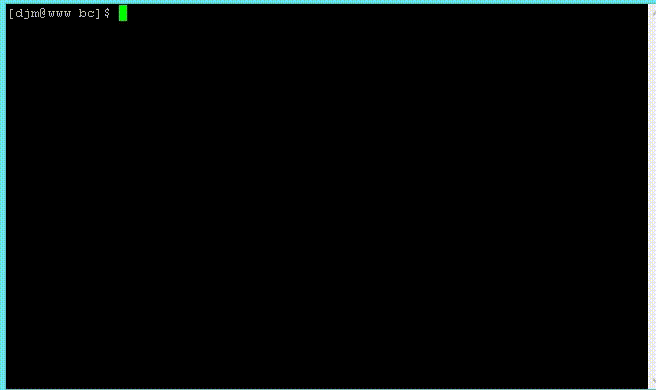

# ArbNum
A simple arbitrary precision library and interactive terminal program.

I tired to do arbitrary signed integer math as clearly as possible.  No crazy optimizations but somewhat performant.  The code is intended to be readable.

# What it can do
- add, subtract, multiply, divide, remainder (mod)
- abs, factorial, gcd, isprime, lcm, max, min, pow, sign, sqrt
- with integers of any length

# Files
- **util.cpp** are some utility functions
- **unsigned.cpp** implements class Unsigned to perform arbitrary precision unsigned integer math.
- **integer.cpp** implements class Integer to perform arbitrary precision signed integer math.
- **scaled.cpp** implements class Scaled perform arbitrary precision real numbers math.
- **bc_tokeniser.cpp** and **bc_tokenizer.h** break the input into text tokens.
- **bc_calc.cpp** and **bc_calc.h** perform the math on the token using Scaled
- **bc.cpp** is just the main

# More details
There is a testAll() function which tests nearly everything in about 20 seconds.

There is a class called Unsigned which performs arbitrary precision unsigned integer operations.

Class Integer uses Unsigned to do arbitrary precision signed integer options.

Class Scaled uses Integer to do signed arbitrary precision real operations.

Has C++ operator overloading so you can to do: a + b * c where they are Scaled's.
You can construct with string, int, long and it has methods toString(), toInt(), toLong() to get values out.
See file example_use_of_scaled.cpp

Compiles on Ubuntu, macOS, Windows
Requires readline-devel package on Fedora
